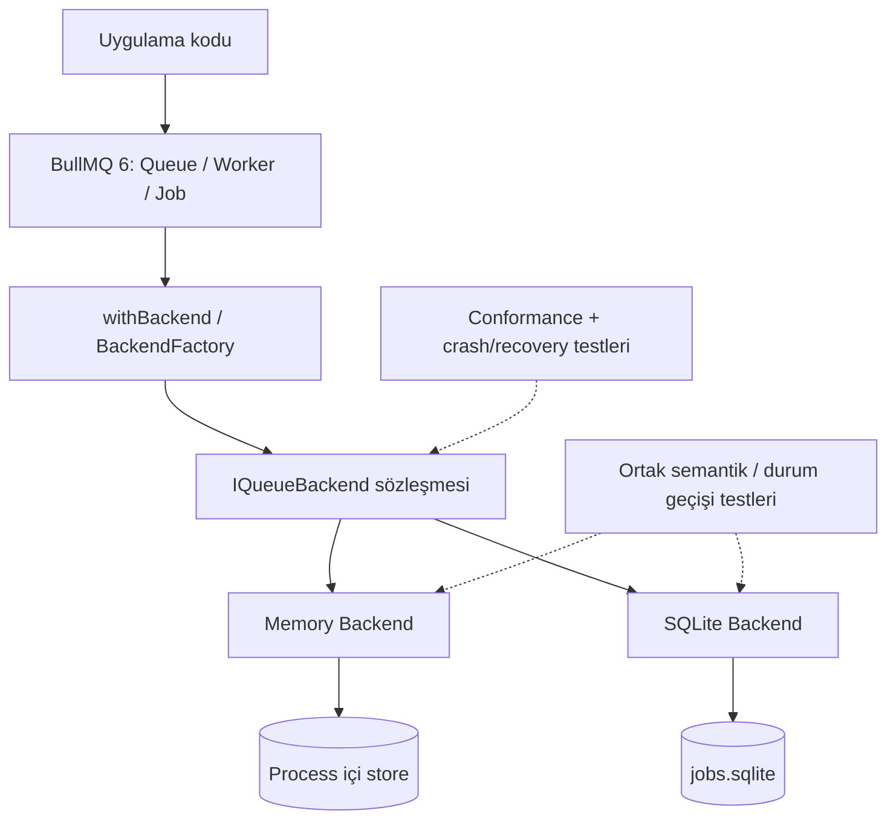
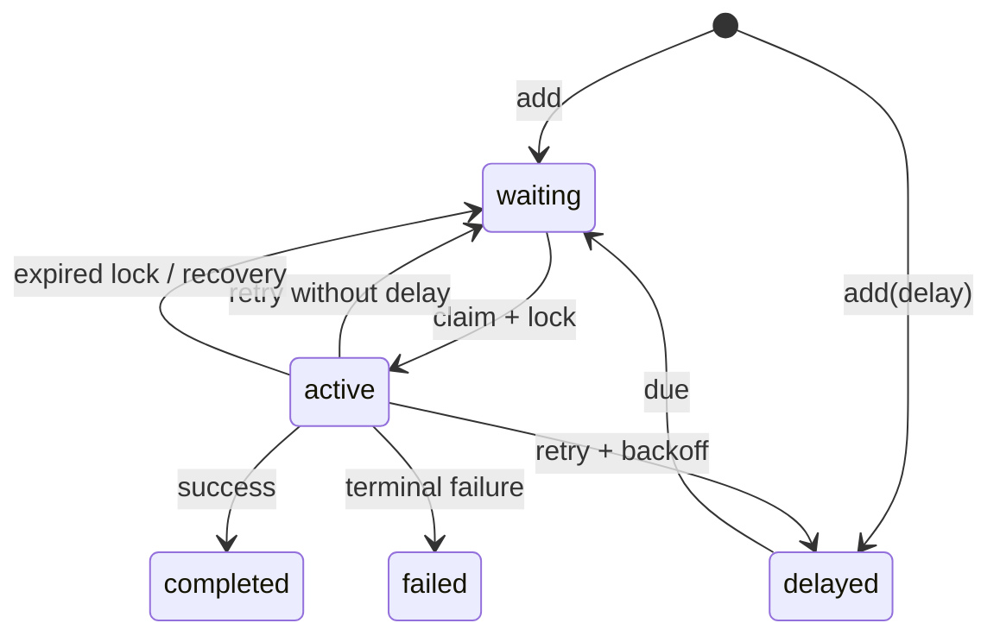

# BullLite — Redis'siz BullMQ Backend'i

> **Proje Tanımı ve Teknik Tasarım Belgesi (PROJECT.md)**  
> **Durum:** Tasarım / henüz uygulanmadı  
> **Tarih:** 21 Ekim 2026  
> **Hedef:** npm üzerinde yayımlanabilecek açık kaynak TypeScript projesi  
> **Lisans önerisi:** MIT (bağımlılık lisansları ve isim/marka kullanımını ayrıca doğrula)

---

## 1. Projenin özeti

**BullLite**, BullMQ'nun `Queue`, `Worker` ve ilgili yüksek seviye API'lerini **Redis kurmadan** kullanabilmek için geliştirilecek alternatif veri deposu backend'leri ailesidir.

- **Memory backend:** Kuyruk ve iş verisini aynı Node.js sürecinin belleğinde tutar. Hızlıdır, test ve geliştirme içindir; süreç kapanınca veriler kaybolur.
- **SQLite backend:** İşleri yerel SQLite dosyasında saklamayı amaçlar. Küçük/tek makine kurulumları için kalıcılık ve yeniden başlatma sonrası kurtarma sunmayı hedefler.
- **Ana entegrasyon noktası:** BullMQ 6'nın `IQueueBackend` / `BackendFactory` soyutlaması ve `withBackend()` fonksiyonu.

**Tek cümlelik değer önerisi:** *“Keep BullMQ's API. Drop the Redis server for development, tests, and small deployments.”*

> **Önemli:** Bu belge uygulanacak ürünün hedefidir; API örnekleri tasarım önerisidir. Şu anda BullLite'ın yayımlandığı, örneklerin çalıştığı veya tüm BullMQ API'leriyle uyumlu olduğu iddia edilmiyor.

### 1.1 Ne değildir?

- Redis protokolünü veya komutlarını taklit eden bir Redis sunucusu **değildir**.
- Redis backend'inin performansının veya dağıtık güvenilirliğinin eşdeğeri **değildir**.
- BullMQ'nun bütün özellikleri için v0.1'de eksiksiz *drop-in replacement* sözü **vermez**.
- Memory modunda süreçler arasında paylaşılan kuyruk veya kalıcı veri **sunmaz**.
- SQLite modunda dağıtık cluster, yüksek erişilebilirlik veya exactly-once teslim garantisi **vadetmez**.

## 2. Neden bu proje?

Geliştiriciler bazen BullMQ'nun iş modeli için ayrı bir Redis servisi kurmak istemez:

1. **Birim/entegrasyon testleri:** İşlerin sıraya alınmasını ve worker işlemeyi Docker/Redis olmadan doğrulamak.
2. **Yerel geliştirme:** Kısa ömürlü iş kuyruklarını basit kurulumla çalıştırmak.
3. **CLI ve masaüstü araçları:** Tek Node.js sürecinde kuyruk yönetmek.
4. **Küçük tek sunuculu uygulamalar:** SQLite seçeneği olgunlaşırsa ek altyapı olmadan kalıcı background job işlemek.
5. **Kütüphane geliştiricileri:** Aynı BullMQ tabanlı uygulama mantığını farklı backend'lerle test etmek.

### 2.1 Kullanıcı profilleri

| Persona | Sorun | Önerilen çözüm |
|---|---|---|
| npm kütüphanesi yazarı | Testler için Redis bağımlılığı | Memory backend |
| Backend geliştirici | Lokal projede ekstra servis | Memory backend |
| Self-hosted geliştirici | Düşük hacimli kalıcı işler | SQLite backend (olgun sürümde) |
| Open-source katkıcısı | Queue semantiğini araştırma | Conformance test seti / örnek uygulamalar |

### 2.2 Başarı sinyalleri

- Belgelenmiş **tek kurulum + 20 satırdan kısa** çalışan temel örnek.
- Redis'e ihtiyaç duymadan tamamlanan *add → process → complete* akışı.
- Tekrarlı ve paralel testlerde deterministik sonuçlar.
- Memory backend'de sıfır veri sızıntısı: bağımsız test namespace'leri birbirinin işlerini görmez.
- V0.1 için hedeflenen BullMQ işlemlerinde uyumluluk testlerinin tamamı geçer.
- Kullanıcıların Redis gerektirmeyen geliştirme ortamı olarak tercih etmesi; GitHub yıldızı tek başına kalite ölçütü değildir.

---

## 3. Mevcut teknik gerçeklik ve kapsam kararı

**21 Ekim 2026 itibarıyla doğrulanan mimari:** BullMQ 6, veri deposundan bağımsız `IQueueBackend` sözleşmesi ve backend oluşturan `BackendFactory` üzerinden çalışabiliyor. `withBackend(factory)` yeni bir backend'e bağlı `Queue`/`Worker` sınıflarını sağlıyor. Redis ve PostgreSQL BullMQ'nun yerleşik backend'leri arasında.

Bu yaklaşımın avantajı, BullMQ sınıflarını yeniden yazmak yerine **veri deposu davranışlarını** uygulamaktır. Zorluğu ise `IQueueBackend` sözleşmesinin geniş olması ve atomik işlemler, lock yönetimi, event'ler, gecikmeli işler gibi önemli davranışların doğru uygulanmasını gerektirmesidir.

### 3.1 Mimari karar (ADR-001)

**Birincil hedef:** BullMQ 6 ile entegre olan custom backend.

**Ön şart / Spike:** Projenin ilk aşamasında aşağıdakiler gerçek TypeScript ile doğrulanacak:

1. Hedeflenen BullMQ 6 sürümüne ait `IQueueBackend` imzaları çıkarılır ve kategorize edilir.
2. `BackendFactory` kullanılarak `withBackend()` bağlantısı tip kontrolünden geçer.
3. Bir işin eklenmesi ve worker tarafından işlenmesi gerçek BullMQ `Queue` ve `Worker` sınıflarıyla çalışır.
4. Temel iş yaşam döngüsü bitiminde `close()` süreçte bekleyen handle bırakmaz.
5. Karşılanması gereken `IQueueBackend` yöntemlerinin kapsam ve efor analizi yapılır.

**Karar kapısı:** Bu deney geçmezse, proje “BullMQ uyumlu backend” olarak pazarlanmaz. Ayrı bir `BullLite Queue/Worker` API'si geliştirilmesi, ayrı teknik karar ve yeni uyumluluk iddiaları gerektirir.

**Önemli:** TypeScript'te `IQueueBackend` arayüzünü yüzeysel stub metotlarla derletmek gerçek uyumluluk anlamına gelmez. Kullanılan BullMQ API'leri, alttaki backend'in çağırdığı bütün operasyonları desteklemek zorundadır. Desteklenmeyen public özellikler belgelenmeli ve test edilmelidir; sessizce yanlış davranış kabul edilemez.

---

## 4. Kullanım deneyimi (tasarlanan public API)

### 4.1 Memory backend

```bash
npm install bullmq @bulllite/memory
```

```ts
import { withBackend } from 'bullmq';
import { createMemoryBackend } from '@bulllite/memory';

const { Queue, Worker } = withBackend(createMemoryBackend);

// 'namespace' örnek bir bağlantı seçeneğidir; nihai tipi spike sonrası netleşir.
const options = { connection: { namespace: 'demo' } };

const queue = new Queue('emails', options);
const worker = new Worker(
  'emails',
  async (job) => {
    console.log('Processing:', job.data.address);
    return { delivered: true };
  },
  { ...options, concurrency: 2 },
);

await queue.add('send-email', {
  address: 'hello@example.com',
});

// Uygulama kapanışında:
await worker.close();
await queue.close();
```

> Bu örnek **hedef kullanım biçimidir**. `createMemoryBackend`, bağlantı seçenekleri ve test edilen BullMQ sürümü uygulanırken kesinleştirilecektir. Ayrı Queue/Worker nesnelerinin aynı namespace içinde **aynı store'u paylaşması** gerekir.

### 4.2 SQLite backend (ileriki sürüm)

```bash
npm install bullmq @bulllite/sqlite
```

```ts
import { withBackend } from 'bullmq';
import { createSQLiteBackend } from '@bulllite/sqlite';

const { Queue, Worker } = withBackend(createSQLiteBackend);

const options = {
  connection: {
    filename: './data/jobs.sqlite',
    busyTimeoutMs: 5000,
  },
};

const queue = new Queue('reports', options);
const worker = new Worker(
  'reports',
  async (job) => generateReport(job.data),
  { ...options, concurrency: 2 },
);

await queue.add('generate-report', { reportId: 'r-123' });
```

SQLite örneği **v0.1 kapsamına dâhil değildir**; dosya kalıcılığı ve hata sonrası recovery doğru uygulanmadan yayımlanmamalıdır.

### 4.3 Paket ve isim stratejisi

Önerilen monorepo paketleri:

| Paket | Görevi | Zaman |
|---|---|---|
| `@bulllite/core` | Backend'lerden bağımsız iç durum modeli, zamanlama ve test yardımcıları | v0.1 |
| `@bulllite/memory` | BullMQ custom memory backend factory | v0.1 |
| `@bulllite/testkit` | Conformance, fake clock ve davranış testleri | v0.2 |
| `@bulllite/sqlite` | Kalıcı SQLite backend | v0.3+ |

**Not:** Bu npm adlarının uygunluğu, BullMQ adı/markasıyla olası benzerliği ve dağıtım hakları yayımdan önce kontrol edilmelidir. Proje README'sinde “Unofficial community project; not affiliated with BullMQ” açıklaması yer almalıdır.

---

## 5. Özellik ve uyumluluk matrisi

Aşağıdaki tablo ürün **hedeflerini** belirtir, mevcut yetenekleri değil.

| Özellik | Memory v0.1 | Memory v0.2+ | SQLite v0.3+ | Not |
|---|---|---|---|---|
| Queue oluşturma / job ekleme | Hedef | Hedef | Hedef | Temel dikey akış |
| Worker ile tüketme | Hedef | Hedef | Hedef | `concurrency` dâhil |
| Job state sorgulama | Hedef | Hedef | Hedef | `waiting/active/completed/failed` |
| FIFO sırası | Hedef | Hedef | Hedef | Aynı öncelikte, delay olmadan |
| Job ID ile yineleneni engelleme | Hedef | Hedef | Hedef | Retention ve unique ID kuralları tanımlanacak |
| Delayed jobs | Deneysel | Hedef | Hedef | Sanal saatle test |
| Retry / fixed / exponential backoff | Deneysel | Hedef | Hedef | Gerçek zamanlı + fake clock |
| Priority jobs | — | Hedef | Hedef | Kararlı sıra tanımı |
| QueueEvents / event stream | — | Hedef | Hedef | Yalnızca EventEmitter eşitliği yetmez |
| Job schedulers | — | Araştırma | Araştırma | BullMQ 6 scheduler semantiği |
| FlowProducer / parent-child | — | Araştırma | Araştırma | Atomik çok-job geçişleri gerekir |
| Pause/resume, remove/clean | Kısmi | Hedef | Hedef | Desteklenen public API'lere göre |
| Lock / stalled recovery | Yalnızca gerek duyulan temel semantik | Hedef | Zorunlu | Üretim güvenilirliği için kritik |
| Process kapanınca verinin korunması | Hayır | Hayır | Hedef | Memory tamamen geçici |
| Çoklu process worker | Hayır | Hayır | Koşullu / test sonrası | SQLite özel koordinasyon ister |
| Çok makine / HA cluster | Hayır | Hayır | Hayır | Kapsam dışı |

**Uyumluluk terminolojisi:**

- **Supported:** İlgili API için davranış ve conformance testi mevcut.
- **Experimental:** Davranış çalışıyor olabilir ama garanti ve uyumluluk yeterince doğrulanmamış.
- **Unsupported:** Çağrı açık bir hata vermeli veya özellik belgede devre dışı belirtilmeli; sahte başarı dönmemeli.

---

## 6. Yüksek seviye mimari



### 6.1 Ortak çekirdek katmanı

Önerilen iç modüller:

- **State machine:** Job durum geçişlerini tanımlar.
- **Clock:** Gerçek/sanal zaman soyutlaması.
- **ID generator:** Çakışmasız job ID üretimi, kullanıcı ID kontrolü.
- **Serializer:** JSON tabanlı payload/result serileştirme (destek sınırları açıkça yazılır).
- **Event model:** Olayların hangi işlemde, hangi sırada yayımlandığını tanımlar.
- **Retry planner:** Attempt limitleri ve backoff zamanı hesaplar.
- **Conformance kit:** Aynı semantik testleri memory ve SQLite backend'lerine uygular.

> Zorunlu mimari notu: BullMQ'nun `IQueueBackend` arayüzü son kararı verir. İç modüller örnektir; BullMQ semantiğiyle çelişen ek bir durum makinesi oluşturulmamalıdır.

### 6.2 Memory backend veri yapıları (taslak)

```ts
interface InternalJob {
  id: string;
  queueName: string;
  name: string;
  payload: unknown;
  status: 'waiting' | 'delayed' | 'active' | 'completed' | 'failed';
  createdAt: number;
  availableAt: number;
  attempt: number;
  maxAttempts: number;
  priority: number;
  sequence: number;
  lockToken?: string;
  lockExpiresAt?: number;
  result?: unknown;
  error?: string;
}

interface QueueState {
  jobs: Map<string, InternalJob>;
  // Gerçek implementasyonda stable FIFO ve delayed priority queue kullanılacak.
  waitingIds: string[];
  activeIds: Set<string>;
  delayedIds: Set<string>;
}
```

`waitingIds` dizisi **anlatım amaçlıdır**; yüksek hacimde `shift()` gibi O(n) işlemlerden kaçınmak için deque/ring buffer tercih edilebilir. `delayedIds` için min-heap, doğrudan sıralı listeye göre daha iyi olabilir. Her backend örneğinin ayrı `Map` yaratıp veriyi parçalamaması gerekir; `(namespace, queueName)` anahtarıyla paylaşılan runtime registry tasarlanmalıdır.

### 6.3 Durum makinesi



Görsel, yalnızca temel job döngüsünü temsil eder. BullMQ'nun `waiting-children`, `prioritized` vb. ek durumları ileriki aşamalarda ve resmî sözleşmeye bağlı olarak ele alınır.

### 6.4 Atomiklik ve yarış koşulları

- **Memory:** Senkron değişiklikler tek Node.js event-loop turunda gerçekleştirilebilir; *await* sınırları arasındaki operasyonların atomik olduğu varsayılamaz. Değişimlerde tek bir senkron transaction benzeri mutasyon katmanı gerekir.
- **SQLite:** İş claim etme, lock oluşturma, sonuç yazma ve retry planlama gibi kritik geçişler transaction içinde olmalıdır. `BEGIN IMMEDIATE` gibi mekanizmaların uygulanabilirliği benchmark ve conformance ile doğrulanır.
- **İki backend:** Job birden fazla worker tarafından aynı anda *claim* edilmemeli. İşin işlenmesi yine de tekrar edebilir; **at-least-once** sınırı korunmalıdır.

---

## 7. Memory backend detayları

### 7.1 İş akışı

1. `queue.add(name, data, options)` çağrısı doğrulanır.
2. Geçerli ID oluşturulur veya verilen ID kontrol edilir.
3. Job uygun `waiting`/`delayed` konumuna eklenir.
4. Worker uygun işi atomik biçimde alır ve lock kaydı oluşur.
5. Processor `async` olarak çalışır.
6. Başarılıysa sonuç yazılır; başarısızsa retry kuralı uygulanır.
7. Event, durum geçişiyle tutarlı biçimde yayımlanır.
8. `close()` çağrısı timer'ları/dinleyicileri temizler; namespace registry kaynakları serbest bırakılır.

### 7.2 Önerilen kurallar

- Default FIFO, aynı öncelik seviyesinde ekleme sırası.
- `concurrency=N` aynı worker içinde en çok `N` *in-flight* processor demektir; CPU paralelliği garantisi değildir.
- Payload/result ilk sürümde JSON-serializable olmalıdır; cycle, `BigInt`, `undefined` ve sınıf örnekleri için açık kabul/hata kuralları gerekir.
- Bağımsız testlerde `namespace` veya örnek runtime kimliği zorunlu olmalıdır.
- Job ID biricikliği `queue + namespace` kapsamında korunur; job temizlendiyse aynı ID'nin yeniden kullanımı ayrıca test edilir.
- Process crash sonrası memory job kaybı **tasarım gereği** gerçekleşir.

### 7.3 Zamanlayıcı tasarımı

Çok sayıda delayed job için her işe ayrı `setTimeout` kurmak yerine tek bir *next due* timer ve min-heap kullanılabilir. Worker uyandırma mantığı, boş kuyrukta sürekli polling yapmamalıdır.

Zaman davranışı test edilebilirlik için `Clock` soyutlamasına bağlıdır:

```ts
interface Clock {
  now(): number;
  sleep(ms: number, signal?: AbortSignal): Promise<void>;
}
```

Bu arayüz yalnızca **iç tasarım önerisidir**; BullMQ'nun gerçek worker bekleme mekanizmasıyla entegrasyon spike aşamasında belirlenir.

---

## 8. SQLite backend detayları (v0.3+)

### 8.1 Kullanım sınırı

SQLite seçeneği *aynı makinede az/orta hacimli* işler için düşünülür. RAM modundan farklı olarak process yeniden başlatıldığında devam edebilmelidir. Bunun için yalnızca `jobs` tablosu yetmez; lock/lease, due-time, retry, event ve recovery tasarlanmalıdır.

### 8.2 Taslak şema

```sql
CREATE TABLE jobs (
  queue_name TEXT NOT NULL,
  id TEXT NOT NULL,
  name TEXT NOT NULL,
  payload_json TEXT NOT NULL,
  state TEXT NOT NULL,
  priority INTEGER NOT NULL DEFAULT 0,
  sequence_no INTEGER NOT NULL,
  attempts_made INTEGER NOT NULL DEFAULT 0,
  max_attempts INTEGER NOT NULL DEFAULT 1,
  available_at INTEGER NOT NULL,
  created_at INTEGER NOT NULL,
  updated_at INTEGER NOT NULL,
  lock_token TEXT,
  lock_expires_at INTEGER,
  result_json TEXT,
  error_text TEXT,
  PRIMARY KEY (queue_name, id)
);

CREATE INDEX jobs_claim_idx
  ON jobs(queue_name, state, available_at, priority, sequence_no);
```

Bu **nihai BullMQ şeması değildir**. Kapsam ilerledikçe events, schedulers, lock history, namespace, metadata ve diğer tablolar eklenebilir. Tarihler için Unix epoch *milisaniye* kullanımı önerilir.

### 8.3 Dayanıklılık kuralları

- WAL modunun, `busy_timeout` ayarının ve transaction tasarımının belgelenmesi.
- Bir worker'ın işi claim ederken lease sahibi olması; lease süresinin uzatılabilmesi.
- Process crash sonrası süresi dolmuş lease'lerin geri kazanılması.
- Kilit token'ı uyuşmuyorsa eski worker'ın sonucu yazamaması (*fencing* davranışı).
- Çoklu process kullanımı ancak yarış testlerinden sonra ayrıca desteklenir.
- Schema migrations ileri/geri uyumluluk politikasıyla yönetilir.
- Veritabanı bağlantısı, dosya kilitlenmesi ve disk dolması durumlarında hatalar sessizce yutulmaz.

### 8.4 Teslim garantisi

**Hedef:** at-least-once işlemeye uyumlu job kurtarma; **garanti edilmeyen:** exactly-once yan etki.

Örneğin worker harici bir ödeme API'sini çağırdıktan sonra sonuç kaydedemeden çökerse, yeniden başlatıldığında job tekrar çalışabilir. Bu nedenle kullanıcıya `idempotency key` ve idempotent processor örnekleri sunulur.

### 8.5 Driver kararı

İki aday: `better-sqlite3` ve desteklenen Node.js sürümlerine göre `node:sqlite`. Seçim kriterleri: dağıtım kolaylığı, Node sürüm matrisi, transaction davranışı, binary gereksinimi, CI uyumluluğu ve performans. İlk aşamada belirli bir driver'a bağlı kamuya açık API yayınlanmaz.

---

## 9. Semantik gereksinimler

### 9.1 Retry/backoff

- `attempts` üst sınırı ve `attemptsMade` sayacının semantiği BullMQ ile karşılaştırmalı test edilir.
- Fixed ve exponential backoff için edge-case testleri: 0 ms, büyük delay, timeout, kapatma.
- Retry sırasında job ID değişmez; event ve durum sırası doğrulanır.
- Duplicate job işlenme ihtimali için idempotency önerilir.

### 9.2 Lock / stalled

- Her aktif işin lease/lock'ı bulunur.
- Lock yenileme ve süresi dolma davranışı test edilir.
- `stalled` bir olaydır; ayrı bir kalıcı job state olarak modellenmesi BullMQ semantiğiyle çelişebilir.
- Event-loop blokajı, worker crash ve sonradan sonuç yazan eski worker senaryoları zorunlu testtir.

### 9.3 Events

`completed`, `failed`, `active`, `waiting`, `stalled` gibi olayların anlamları gerçek BullMQ sınıfları üzerinden doğrulanacaktır. Basit in-process `EventEmitter`, BullMQ `QueueEvents` semantiğiyle otomatik olarak eşdeğer sayılmaz.

### 9.4 Sıralama

- Aynı öncelikte, eş zamanlı erişim olmadan FIFO.
- Priority desteklendiğinde BullMQ'nun priority yönü ve ordering kuralları benchmark/testle teyit edilecek.
- Farklı worker concurrency seviyelerinde **tamamlanma sırasının** FIFO olacağı iddia edilmez.

### 9.5 Kapatma ve kaynak temizliği

- `worker.close()` sonrasında yeni işler tüketilmez.
- Graceful shutdown davranışı desteklenen API kapsamında tanımlanır.
- Kapanış sonunda açık timer/handle kalmaz; test process'i doğal biçimde sonlanır.

---

## 10. Önerilen repo yapısı

```text
bulllite/
├── .github/
│   ├── workflows/
│   │   ├── ci.yml
│   │   ├── release.yml
│   │   └── security.yml
│   └── ISSUE_TEMPLATE/
├── apps/
│   └── examples/
│       ├── basic-memory/
│       ├── retries/
│       └── sqlite-restart/     # sonraki sürüm
├── packages/
│   ├── core/
│   │   └── src/
│   │       ├── clock.ts
│   │       ├── job-state.ts
│   │       ├── retry.ts
│   │       └── serialization.ts
│   ├── memory/
│   │   └── src/
│   │       ├── index.ts
│   │       ├── factory.ts
│   │       ├── backend.ts
│   │       ├── store.ts
│   │       └── scheduling.ts
│   ├── testkit/
│   │   └── src/
│   │       ├── conformance.ts
│   │       └── fake-clock.ts
│   └── sqlite/
│       └── src/
│           ├── factory.ts
│           ├── backend.ts
│           ├── migrations/
│           └── lease.ts
├── tests/
│   ├── integration/
│   ├── conformance/
│   ├── races/
│   └── recovery/
├── docs/
│   ├── architecture.md
│   ├── compatibility.md
│   ├── guarantees.md
│   ├── benchmarks.md
│   └── contributing.md
├── PROJECT.md
├── README.md
├── CONTRIBUTING.md
├── LICENSE
├── package.json
├── pnpm-workspace.yaml
└── tsconfig.base.json
```

Repo için **pnpm workspaces + TypeScript strict + Vitest + ESLint + Prettier + Changesets** önerilir. ESM/CJS paketleme kararında yayınlanan çıktı gerçek consumer projeleriyle test edilmelidir.

---

## 11. Sürüm planı ve iş paketleri

### Faz 0 — Teknik fizibilite / spike

- [ ] BullMQ 6'nın hedef sürümünü sabitle.
- [ ] `IQueueBackend` metod envanterini çıkar (isim / çağıran sınıf / atomiklik / öncelik).
- [ ] Gerçek `withBackend()` kullanımı için minimal factory prototipi oluştur.
- [ ] `Queue.add` → `Worker` → `completed` yolunu tek Node sürecinde çalıştır.
- [ ] `close()` ve import/type kontrolünü doğrula.
- [ ] Entegrasyon risklerini ve uygulanabilir kapsamı `docs/compatibility.md` dosyasına yaz.

**Çıkış kriteri:** Hem runtime hem TypeScript derlemesiyle doğrulanmış çalışan örnek. Başarısızsa hedef mimari yeniden değerlendirilir.

### Faz 1 — Memory MVP / v0.1.0-alpha

- [ ] İzole namespace ve paylaşılan store.
- [ ] Add / claim / process / complete / fail.
- [ ] Temel job state ve job ID davranışı.
- [ ] Worker concurrency ve kaynak temizliği.
- [ ] Hata yönetimi; desteklenmeyen API'ler için açık uyumluluk listesi.
- [ ] README örneği, CI, temel integration test.

**Çıkış kriteri:** Belgelenen temel senaryolar gerçek BullMQ sınıflarıyla Redis olmadan çalışır. Deneysel etiket korunur.

### Faz 2 — Memory kalite / v0.2.x

- [ ] Delayed jobs için güvenilir zamanlama.
- [ ] Retry + fixed/exponential backoff.
- [ ] Priority ve deduplication semantiği.
- [ ] Event ve lock davranışlarının doğrulanması.
- [ ] Fake-clock temelli deterministik testler.
- [ ] BullMQ adapter conformance testlerinin uygulanabilir kapsamını karşıla.
- [ ] Bellek artışı, timer sızıntısı, concurrency race testleri.

**Çıkış kriteri:** Her desteklenen API için belgelenmiş conformance testi ve bilinen sınırlamalar.

### Faz 3 — SQLite prototip / v0.3.x-alpha

- [ ] Transaction tabanlı job store ve migration altyapısı.
- [ ] Restart sonrası waiting/delayed/active kayıtlarını ele alma.
- [ ] Lease/lock token, recovery ve requeue.
- [ ] Disk hata senaryoları, WAL ve locking testleri.
- [ ] Dosya kalıcılığı örneği ve README.

**Çıkış kriteri:** Çökme ve restart testleri başarılı; çoklu process desteği henüz ayrıca doğrulanmamışsa açıkça **unsupported**.

### Faz 4 — Üretim olgunluğu / v1.0 değerlendirmesi

- [ ] Hedeflenen tüm BullMQ public API'leri için uyumluluk matrisi.
- [ ] Resmî adapter-conformance ve mümkün olan BullMQ test suiteleri.
- [ ] 24+ saatlik stres testi; crash/kill/restart testleri.
- [ ] Ölçülmüş performans ve kaynak tüketimi raporu.
- [ ] SemVer, migration, güvenlik, desteklenen Node ve BullMQ sürümü politikaları.
- [ ] Kullanıcı dokümantasyonunda veri kaybı, teslim garantisi, sınırlamalar.

**Çıkış kriteri:** “Production-ready” ifadesi ancak koşulların tamamı sağlandıktan sonra kullanılabilir.

---

## 12. Test stratejisi

### 12.1 Test katmanları

| Katman | Soru | Araç/örnek |
|---|---|---|
| Unit | Durum makinesi ve backoff doğru mu? | Vitest, fake clock |
| Integration | Gerçek BullMQ Queue/Worker çalışıyor mu? | BullMQ + memory backend |
| Contract | Backend BullMQ semantiğine uyuyor mu? | BullMQ adapter conformance |
| Concurrency | İki worker aynı işi claim ediyor mu? | Race/barrier testleri |
| Recovery | SQLite restart sonrası işler kayboluyor mu? | Child process + kill/restart |
| Stability | Timer, listener ve RAM sızıntısı var mı? | Repeated lifecycle tests |
| Compatibility | Farklı BullMQ/Node sürümleriyle çalışıyor mu? | CI matrix |

### 12.2 Asgari test senaryoları

1. Tek iş bir kez *claim* edilir, işlem bitince `completed` görünür.
2. İki worker aynı pending job'u aynı anda alamaz.
3. Processor hata verince iş `failed` veya belirtilen retry durumuna geçer.
4. Delayed job zamanından önce başlamaz.
5. Aynı ID iki defa eklendiğinde Belgelenen BullMQ eşdeğeri davranış görülür.
6. `concurrency: 2` ile aynı anda en çok iki processor çalışır.
7. İki namespace işlerini birbirinden ayırır.
8. Worker kapanınca event listener ve timer sızmaz.
9. Memory process kapanınca veriler kalmaz (beklenen davranış).
10. SQLite çalışırken process öldürülüp yeniden açıldığında bekleyen işler kurtarılır.
11. SQLite lease süresi biten iş tekrar alınabilir; eski token sonuç yazamaz.
12. Her backend'in desteklemediği işlemler açık ve belgelenmiş şekilde reddedilir.

### 12.3 CI matrisi (öneri)

- İşletim sistemi: Linux, Windows, macOS (Memory); SQLite driver destekliyorsa aynı matris.
- Node.js: 20, 22, 24 — sürüm desteği ve EOL durumu yayımlamadan önce doğrulanmalı.
- BullMQ: Belirli bir test edilmiş `6.x` aralığı; `peerDependencies` buna göre ayarlanır.
- Paketleme: ESM/CJS, `npm pack`, TypeScript declaration resolution.

### 12.4 Performans kriterleri

Ölçümler **yapılmadan** “Redis'ten hızlı” gibi iddialar kullanılmaz.

Benchmark metrikleri:

- `add` ops/s (1k / 10k / 100k job)
- Job latency p50/p95/p99
- Worker throughput (concurrency 1/4/16)
- Bellek kullanımı (100k queued job)
- Delayed job timer doğruluğu
- SQLite veritabanı boyutu ve fsync/transaction maliyeti

Benchmark koşulları, donanım, Node sürümü ve BullMQ sürümü raporda sabitlenir. Farklı dayanıklılık seviyelerini aynı benchmark kategorisinde kıyaslamak yanıltıcı olabilir.

---

## 13. Hata modeli ve güvenilirlik riskleri

| Risk | Etki | Önlem / karar |
|---|---|---|
| Geniş `IQueueBackend` sözleşmesi | MVP eforu artar | Önce metot envanteri ve çalışan spike |
| Memory backend her factory çağrısında ayrışır | Worker işi göremez | Namespace başına paylaşılan store |
| Double claim | Aynı job paralel işlenir | Atomik claim + yarış testleri |
| Worker çöker | Active job takılı kalır | Lock/lease ve stalled recovery |
| Event loop bloklanır | Lock süresi biter | Belgeleme, yenileme ve sahte saat testleri |
| SQLite database busy | Job işlemleri başarısız | Kısa transaction, timeout, retry/raporlama |
| Yanlış retry semantiği | Gereksiz tekrar/iş kaybı | BullMQ davranış testleri |
| Memory büyümesi | OOM | Retention, cleanup, memory benchmark |
| Yanlış "drop-in" pazarlaması | Kullanıcı güven kaybı | Açık uyumluluk tablosu ve semantik sürümleme |
| BullMQ minor değişiklikleri | Backend kırılabilir | Peer sürüm aralığı, düzenli conformance CI |
| Çoklu SQLite worker yarışı | Çift işleme/veri bozulması | Test edilmedikçe multi-process desteği yok |

---

## 14. Güvenlik ve sınırlar

- Job payload'ları hassas veri içerebilir; log'larda payload varsayılan olarak gösterilmemeli.
- SQLite veritabanı içeriği disk üzerinde şifrelenmiş kabul edilmez; uygulama dosya izinlerinden sorumludur.
- Worker processor kodu normal Node.js yetkileriyle çalışır; BullLite **sandbox** sağlamaz.
- Harici kullanıcıdan gelen job name ve payload için uygulama düzeyinde doğrulama gerekir.
- Unlimited queue growth için koruma ve cleanup stratejisi tasarlanmalı.
- Dosya yolu/namespace parametrelerinin güvenli işlenmesi gerekir.
- `jobId` bir *idempotency primitive* olabilir ancak harici yan etkileri otomatik olarak tekilleştirmez.
- İzleme/metrics varsa kişisel ve hassas veriler varsayılan olarak hariç tutulmalıdır.

---

## 15. Dokümantasyon ve açık kaynak stratejisi

### README ana sayfa önerisi

```text
BullLite
BullMQ-compatible backends without a Redis server.

✅ In-memory backend for tests and local development
🧪 Works with real BullMQ Queue/Worker classes (supported subset)
💾 SQLite backend (planned / experimental)
⚠️ Not a Redis replacement or HA distributed queue
```

### README sıralaması

1. 5–10 saniyede anlaşılacak değer önerisi.
2. Gerçekten çalışan 20 satırlık kod örneği.
3. Desteklenen/deneysel/desteklenmeyen özellik matrisi.
4. Memory ve SQLite arasındaki güvenilirlik farkı.
5. Installation ve Node/BullMQ version policy.
6. Benchmarks (ölçülmüşse).
7. Roadmap ve good first issue'lar.
8. README GIF/terminal demo ve sınırlamalar.

### Sürüm ilkeleri

- `0.x`: Yalnızca açıkça işaretlenmiş destek kapsamı; API değişiklikleri sürüm notlarında.
- `1.0`: Semantik uyumluluğu tanımlanmış, conformance ile doğrulanmış sürüm.
- `CHANGELOG.md`: Her değişiklikte kırıcı etkiler ve migration notları.
- Dependabot/Renovate ve Changesets ile otomatik PR/sürüm süreçleri.
- npm Trusted Publishing (OIDC) ve uygun provenance ayarları kullanılabilir.

### İlk katkı işleri

- [ ] README için minimal BullMQ örneği.
- [ ] Job state transition testleri.
- [ ] Namespace izolasyon testi.
- [ ] Fake clock implementation.
- [ ] Retry/backoff uç durum testleri.
- [ ] SQLite restart fixture.
- [ ] Compatibility matrix generator.

---

## 16. Açık kararlar / araştırma soruları

1. `IQueueBackend`'in kesin olarak kaç ve hangi operation'ı ilk dikey akış için gerekiyor?
2. Aynı namespace'in backend factory çağrıları arasında paylaşımı ve yaşam döngüsü nasıl yönetilecek?
3. `QueueEvents` için gerçek BullMQ event-stream semantiği nasıl karşılanacak?
4. `close()` sırasında namespace store hangi koşulda serbest bırakılacak?
5. Delayed job scheduler gerçek BullMQ backend sözleşmesindeki hangi operation'ları kullanıyor?
6. SQLite için hangi sürücü seçilmeli; hangi Node sürümlerinde desteklenmeli?
7. Çoklu process SQLite kullanımı gerçekten ürün gereksinimi mi, yoksa tek-process ile mi sınırlanmalı?
8. Memory ve SQLite ortak durum makinesini ne ölçüde paylaşabilir?
9. `BullLite` adı ve npm scope'u kullanılabilir mi; marka karışıklığı riski var mı?
10. İlk hedef kitle sadece **tests/dev** mi, yoksa SQLite ile **small production** mı? (İlk yayın için test/dev önerilir.)

---

## 17. "Done" tanımı ve ilk geliştirme görevi

### İlk teslim (v0.1 alpha) kabul kriterleri

- [ ] Tek komutla kurulan memory backend paketi.
- [ ] Gerçek BullMQ 6 `Queue` ve `Worker` ile add → process → complete çalışıyor.
- [ ] `concurrency`, duplicate ID ve hata durumu için testler var.
- [ ] `close()` handle bırakmıyor.
- [ ] En az Linux üzerinde CI geçiyor.
- [ ] README'deki kod örnekleri CI'da derlenip çalıştırılıyor.
- [ ] `docs/compatibility.md` açıkça hangi BullMQ API'lerinin desteklendiğini listeliyor.
- [ ] Redis kurulumuna ihtiyaç duyulmuyor.
- [ ] Proje *experimental* olarak etiketleniyor; üretim garantisi verilmiyor.

### İlk PR başlığı

**`feat(memory): prove BullMQ v6 backend integration with minimal job lifecycle`**

**PR kapsamı:** Repository iskeleti, BullMQ peer dependency, basit memory state store, backend factory, minimum gerçek BullMQ entegrasyon testi ve README örneği. SQLite, dashboard, rate limiting ve job schedulers ilk PR'a dâhil edilmez.

---

## 18. Referanslar ve doğrulama kaynakları

Araştırma tarihi: **21 Ekim 2026**. Uygulama başlamadan önce sürümler yeniden kontrol edilmelidir.

1. **BullMQ Connections / custom backends:** https://docs.bullmq.io/guide/connections  
   `IQueueBackend`, `BackendFactory`, `withBackend()` ve production-grade backend uyarıları.
2. **BullMQ `withBackend` API:** https://docs.bullmq.io/api/functions/v6.withBackend.html  
   Factory bağlama ve connection seçeneklerinin tip kontrolü.
3. **BullMQ PostgreSQL backend:** https://docs.bullmq.io/guide/postgresql  
   Yüksek seviye BullMQ API'lerinin alternatif datastore'da kullanım örneği.
4. **BullMQ v6 changelog:** https://docs.bullmq.io/changelog  
   v6 backend soyutlaması ve kırıcı değişiklikler.
5. **BullMQ Stalled Jobs:** https://docs.bullmq.io/guide/workers/stalled-jobs  
   Lock yenileme, stalled davranışı ve processor blokajı.
6. **BullMQ Retry:** https://docs.bullmq.io/guide/retrying-failing-jobs  
   Retry ve fixed/exponential backoff.
7. **BullMQ Job Schedulers:** https://docs.bullmq.io/guide/job-schedulers/  
   BullMQ 6'da tekrarlayan işler için kullanılan yaklaşım.
8. **BullMQ kaynak deposu ve lisansı:** https://github.com/taskforcesh/bullmq  
   Lisans, referans implementasyon ve conformance testleri.

---

## 19. Son karar özeti

**Önce:** BullMQ v6 custom backend ile gerçek bir uçtan uca proof of concept.  
**Sonra:** Deterministik, izole, güvenilir Memory backend.  
**Ardından:** Retry, delayed, events, kapsamlı conformance.  
**Daha sonra:** SQLite kalıcılığı, kilitler, recovery ve işlem güvenilirliği.  
**En sonunda:** Stres testlerini ve uyumluluk matrisini tamamladıktan sonra üretim uygunluğu değerlendirmesi.

> **Projenin ayırt edici niteliği:** “BullMQ gibi görünen yeni bir kuyruk” değil; uygun ölçüde desteklenen gerçek BullMQ API'lerini farklı storage motorlarında çalıştıran, davranışı test edilmiş backend'ler sunmak.
